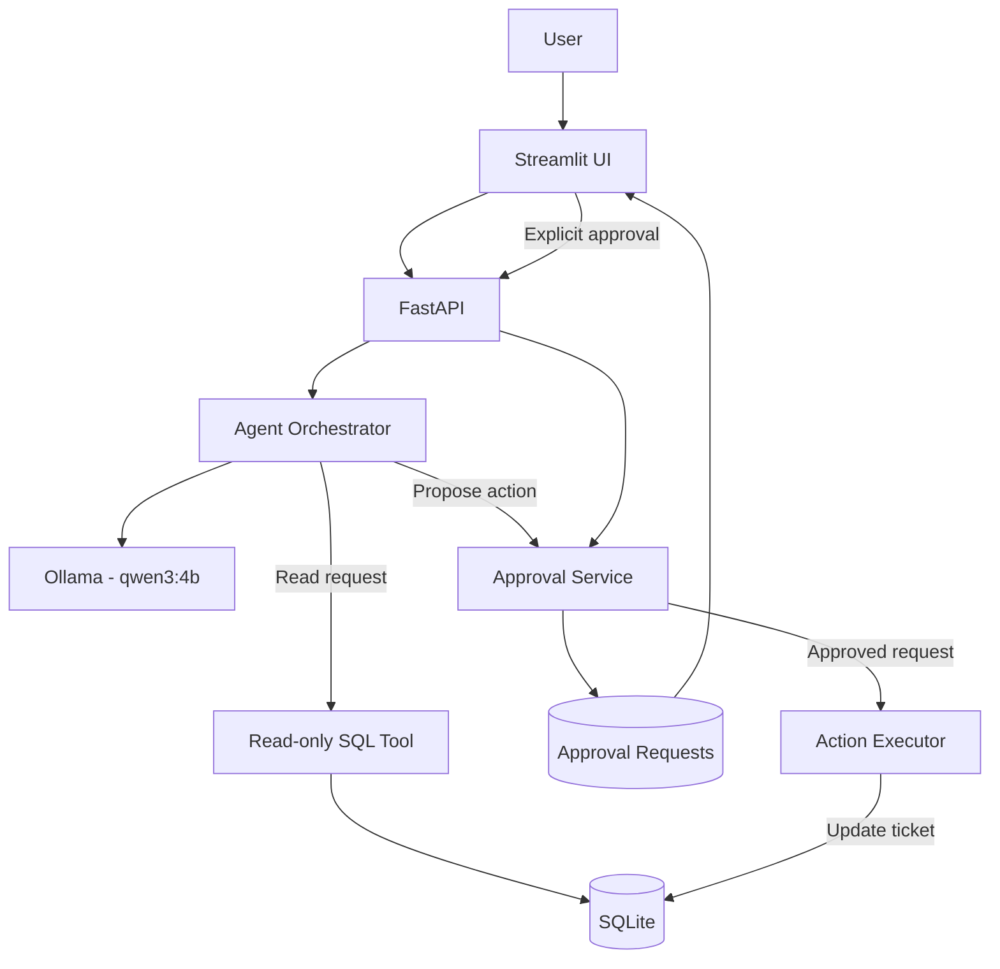

# Nova — Enterprise AI Agent Platform

**A local-first AI agent platform for enterprise support workflows, with read-only database access and human-approved actions.**

Nova is a portfolio project exploring how to integrate a locally hosted language model into a structured enterprise workflow. It combines a conversational interface, controlled database queries, and an approval-based action lifecycle to demonstrate practical agent engineering beyond text generation.

The central design principle is simple: **the agent can propose an action, but it cannot execute that action on its own.** A human must explicitly approve the request, and execution is handled as a separate operation.

## Key Features

- **Local LLM inference:** Uses Ollama with `qwen3:4b`, avoiding a paid LLM API dependency for local inference.
- **Conversational agent:** Interprets user requests and routes them to a response, database-query, or support-ticket action-request workflow.
- **Controlled database access:** Provides a read-only SQL tool for querying customer and support-ticket data.
- **Human-in-the-Loop (HITL):** Requires explicit approval before a proposed support-ticket action can be executed.
- **Approval lifecycle management:** Tracks pending, approved, rejected, executed, and failed requests.
- **Duplicate pending-request prevention:** Avoids creating another pending request for the same action and ticket.
- **Approval dashboard:** Displays request counts, filters by status, and groups requests by ticket.
- **REST API:** Exposes agent interactions and approval operations through FastAPI.
- **Automated tests:** Includes a confirmed suite of 33 passing tests.

## Architecture

Nova separates the user interface, API layer, agent logic, database access, and action execution into distinct responsibilities.



### Components

| Component          | Responsibility                                                                              |
| ------------------ | ------------------------------------------------------------------------------------------- |
| Streamlit UI       | Chat interface, approval dashboard, status filters, and action controls.                    |
| FastAPI            | REST API for health checks, chat, approval management, and execution requests.              |
| Agent orchestrator | Uses the local model to interpret requests and coordinate supported workflows.              |
| Ollama / Qwen3 4B  | Local language-model inference.                                                             |
| Read-only SQL tool | Executes restricted queries against permitted database tables.                              |
| Approval service   | Validates action requests, manages approval state, and prevents duplicate pending requests. |
| Action executor    | Executes supported actions through a separate, approval-gated operation.                    |
| SQLite             | Stores demonstration customer data, support tickets, and approval requests.                 |

### Technology Stack

- **Language:** Python
- **API:** FastAPI
- **Frontend:** Streamlit
- **LLM runtime:** Ollama
- **Model:** `qwen3:4b`
- **Database:** SQLite
- **Testing:** pytest

## Human-in-the-Loop Workflow

Nova treats actions that modify business data differently from read-only queries.

The support-ticket closure workflow follows these steps:

1. **Request:** A user asks Nova to close a support ticket.
2. **Validation:** The application validates the ticket identifier and checks that the ticket exists and is in a supported state.
3. **Proposal:** Nova creates an approval request instead of modifying the ticket.
4. **Human review:** The request appears in the Approval Center, where the user can approve or reject it.
5. **Separate execution:** An approved request can be executed through a distinct operation.
6. **Outcome tracking:** The application records the request's resulting status and execution result.

The approval lifecycle is:

`pending → approved → executed`

Alternative outcomes include `rejected` and `failed`.

**Important design decisions:**

- A model-generated response is not authorization to modify data.
- A pending request cannot be executed.
- Approval and execution are separate steps.
- Rejected requests are not executed.
- Repeated requests for the same action and ticket do not create additional pending approval requests.
- A new request can be created after a previous request has been rejected.

The approval service uses a SQLite transaction with `BEGIN IMMEDIATE` when creating requests, helping coordinate concurrent request creation.

These controls demonstrate an explicit human authorization boundary rather than unrestricted autonomous execution.

## Security and Guardrails

Nova implements several application-level controls to reduce the risks associated with AI-assisted database operations.

### Read-only SQL access

The database query tool restricts access to the `customers` and `support_tickets` tables and incorporates the following safeguards:

- Read-only SQLite connection.
- Query-only database mode.
- SQLite authorizer to block write operations and access to unauthorized tables.
- Query timeout of two seconds.
- Maximum result set of 100 rows.
- SQLite virtual-machine instruction limit.
- Restrictions against executing multiple SQL statements in a single request.

These controls limit the database operations available through the query tool. They do not eliminate every possible database or application security risk.

### Action controls

- The agent proposes actions rather than executing them autonomously.
- The approval service validates action parameters and ticket state.
- Duplicate pending requests are checked within a transaction.
- Execution is handled separately from approval.
- Approval states and action outcomes are persisted in SQLite.

### Public repository precautions

This project is a local development and demonstration application, not a production-ready enterprise deployment.

Before publishing or running it with sensitive data:

- Do not commit credentials, API tokens, private configuration, or real customer data.
- Do not publish a populated database containing sensitive information.
- Keep the API and UI bound to localhost unless a deployment has appropriate access controls.
- Review the code and configuration before exposing any endpoint publicly.

**Known security limitations:** The application does not currently implement authentication or role-based authorization. The local API and UI should therefore be treated as trusted development interfaces, not as secure public services. Human approval in the workflow is not a substitute for authenticated user identity and authorization.

## Testing

Nova has a **confirmed test suite of 33 passing tests**.

Run the suite from the project root:

```bash
pytest -v
```

The tests cover approval-service behavior, including duplicate pending-request prevention and allowing a new request after a previous request has been rejected. The wider backend test suite also covers action-execution rules and restrictions on database queries.

The reported result is based on the latest confirmed test run; rerun the suite after making changes to verify the current checkout.

## Installation

### Prerequisites

- Python installed and available on your PATH.
- [Ollama](https://ollama.com/) installed and running.
- Git.
- The project dependencies listed in `requirements.txt`.

### 1. Clone the repository

Replace the placeholder with the URL of your public GitHub repository.

```bash
git clone https://github.com/SleepWalKer09/nova
cd enterprise-ai-agent
```

### 2. Create a virtual environment

On Windows PowerShell:

```powershell
python -m venv .venv
.\.venv\Scripts\Activate.ps1
```

If PowerShell blocks script activation, use the activation method appropriate for your environment or run the project with the virtual environment's Python executable directly.

### 3. Install dependencies

```bash
python -m pip install --upgrade pip
pip install -r requirements.txt
```

### 4. Download the local model

```bash
ollama pull qwen3:4b
```

Confirm that Ollama can access the model:

```bash
ollama list
```

Keep the Ollama service running while using Nova.

### 5. Start the API

From the repository root, open a terminal and run:

```bash
uvicorn app.main:app --reload
```

The API is configured for local development at:

`http://127.0.0.1:8000`

Interactive API documentation is available at:

`http://127.0.0.1:8000/docs`

### 6. Start the Streamlit interface

Open a second terminal, activate the same virtual environment, and run:

```bash
streamlit run app/streamlit_app.py
```

Open the local URL printed by Streamlit in your browser.

> **Database setup:** Nova uses SQLite and stores its database at `data/nova.db`. Ensure the application's existing initialization flow has created the database and demonstration data before trying the workflows. Do not use real customer records in the public demo.

## Usage

### Chat with Nova

Use the **Nova Chat** tab to ask questions about the available demonstration data or request a supported action.

Example prompts:

```text
Show me the available support tickets.
```

```text
Find tickets that are currently open.
```

```text
Request to close support ticket 101.
```

These are example prompts; the actual response depends on the available data and the agent's interpretation.

### Review action requests

Open the **Approval Center** to:

- View request counts by status.
- Filter requests by approval state.
- Review requests grouped by support ticket.
- Approve or reject pending requests.
- Execute approved requests as a separate step.
- Inspect recorded outcomes.

Nova is designed to make the proposed action and its status visible before any supported ticket modification is executed.

### Explore the API

The FastAPI application exposes endpoints for health checks, chat, approval creation, request listing and summaries, individual approval requests, approval, rejection, and execution.

Useful entry points include:

| Endpoint                               | Purpose                            |
| -------------------------------------- | ---------------------------------- |
| `GET /health`                          | Health check.                      |
| `POST /chat`                           | Send a message to the agent.       |
| `POST /approvals`                      | Create an approval request.        |
| `GET /list_approvals`                  | List approval requests.            |
| `GET /approvals/summary`               | Retrieve counts grouped by status. |
| `GET /approvals/{request_id}`          | Retrieve an individual request.    |
| `POST /approvals/{request_id}/approve` | Approve a request.                 |
| `POST /approvals/{request_id}/reject`  | Reject a request.                  |
| `POST /approvals/{request_id}/execute` | Execute an approved request.       |

For exact request bodies, response schemas, and behavior, use the interactive documentation at `/docs`.

## Project Structure

The following is a simplified overview of the main modules:

```text
enterprise-ai-agent/
├── app/
│   ├── agent/
│   │   └── agent.py
│   ├── approval_service.py
│   ├── database.py
│   ├── database_tool.py
│   ├── main.py
│   └── streamlit_app.py
├── data/
│   └── nova.db
├── tests/
├── pytest.ini
└── requirements.txt
```

The database file is runtime data rather than source code. Consider excluding generated or populated database files from version control and providing a reproducible database initialization path for reviewers.

## Limitations

Nova is an engineering demonstration, and its current scope is intentionally constrained.

- **Single supported action workflow:** Ticket closure is the primary implemented write operation.
- **Local model dependency:** Inference depends on a functioning Ollama installation and the downloaded model.
- **Model reliability:** The model may misunderstand prompts or generate incorrect interpretations and SQL suggestions. Model output must not be treated as inherently trustworthy.
- **No authentication or RBAC:** User identity, permissions, and separation of approver roles are not implemented.
- **Local SQLite storage:** The project is not designed for concurrent enterprise workloads or distributed deployment.
- **No production observability stack:** Enterprise-grade tracing, monitoring, alerting, and audit infrastructure remain future work.
- **No public deployment hardening:** Network exposure, rate limiting, transport security, and deployment-specific controls require additional engineering.
- **Demo data:** The project is intended to be evaluated with non-sensitive demonstration records.

## Roadmap

Potential next steps include:

- [ ] Add authentication and role-based authorization.
- [ ] Separate requester and approver permissions.
- [ ] Strengthen duplicate-request detection and add controls to prevent approval-queue flooding.
- [ ] Expand auditability with structured logs and trace identifiers.
- [ ] Add more supported business actions with explicit authorization policies.
- [ ] Improve tool-call validation and test adversarial or malformed model outputs.
- [ ] Add CI workflows for automated testing and code quality checks.
- [ ] Containerize the application and document a hardened deployment architecture.
- [ ] Evaluate a production database and concurrency strategy for multi-user environments.
- [ ] Add operational metrics, monitoring, and failure diagnostics.

## Design Philosophy

Nova explores a practical approach to building AI agents for enterprise workflows:

- **Constrain capabilities instead of trusting model instructions alone.**
- **Separate read-only information retrieval from state-changing operations.**
- **Require explicit human approval for supported actions.**
- **Keep approval and execution as distinct operations.**
- **Test critical business rules and failure paths.**

The objective is not to maximize autonomy at any cost. It is to demonstrate how an AI agent can be integrated into a workflow with clear boundaries, observable state, and human control.

---

**Project status:** Portfolio project · Local inference · 33 confirmed passing tests · Not production-ready
